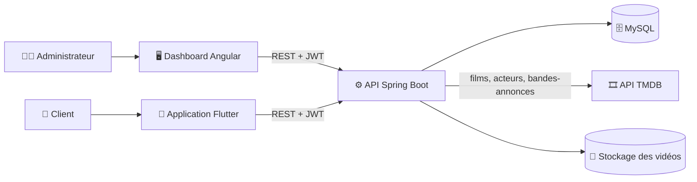
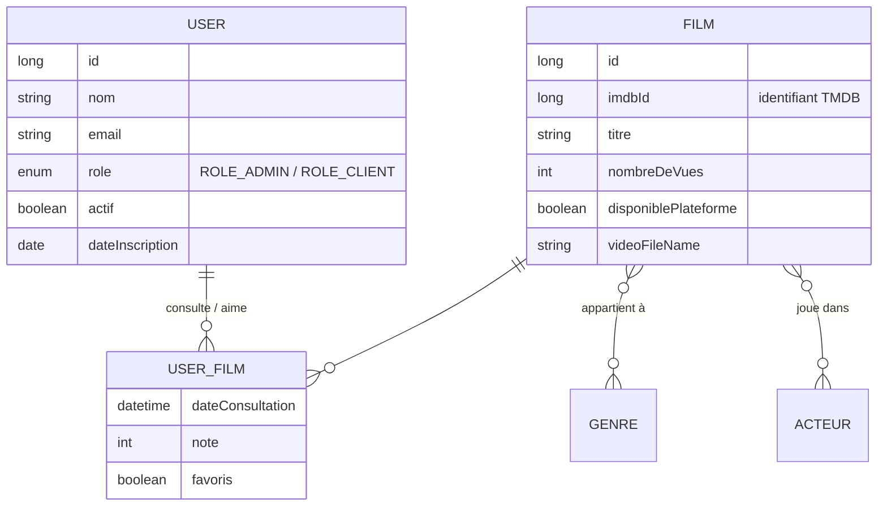

# 🎬 Smart Movie Platform

> Plateforme complète de **découverte, de recommandation et de streaming de films**, composée d'une API **Spring Boot**, d'un dashboard d'administration **Angular** et d'une application mobile **Flutter**.
> Projet réalisé pendant mes stages chez **Cyber Kairouan** : stage d'été 2025 (API et dashboard d'administration) et stage PFA 2026 (application mobile client).


---

## 🧩 Les trois applications

| | Application | Technologies | Pour qui | Dépôt |
|---|---|---|---|---|
| ⚙️ | **API back-end** | Java 17, Spring Boot 3.5, Spring Security, JPA, MySQL | Toutes les applications | [smart-movie-recommendation](https://github.com/mayssadhahri1/smart-movie-recommendation) |
| 🖥️ | **Dashboard d'administration** | Angular 17, TypeScript, Chart.js, Angular Material | Administrateur | [smart-movie-admin](https://github.com/mayssadhahri1/smart-movie-admin) |
| 📱 | **Application mobile** | Flutter, Dart | Client | à venir |

## 🏗️ Architecture



## ✨ Ce que fait la plateforme

### Côté client (application mobile)
- 🔐 Inscription, connexion classique et **connexion Google**
- 🎞️ Catalogue de films : populaires, mieux notés, tendances, recherche par titre et par genre
- 📄 Fiche détaillée : synopsis, acteurs, bande-annonce
- ❤️ Favoris et 🕒 historique de visionnage
- 🎯 **Recommandations personnalisées** calculées à partir des genres préférés de l'utilisateur
- ▶️ **Lecture en streaming** des films hébergés sur la plateforme

### Côté administrateur (dashboard web)
- 📊 Tableau de bord : utilisateurs, films consultés, favoris, genres populaires, inscriptions par semaine
- 👥 Gestion des utilisateurs : recherche, activation / désactivation, modification, suppression
- 🎬 Ajout de films avec **upload de la vidéo**, modification, suppression et prévisualisation
- 🛰️ Surveillance : activité récente, dernières connexions, état de l'API TMDB

### Côté serveur (API)
- 🔒 Sécurité **Spring Security + JWT**, rôles `ADMIN` / `CLIENT`
- 🔌 Intégration de l'**API TMDB** et enregistrement des films, genres et acteurs dans la base
- 📼 **Streaming vidéo progressif** avec les en-têtes HTTP `Range` (`206 Partial Content`)
- 📘 Documentation interactive **Swagger / OpenAPI**

## 🗃️ Modèle de données



## 🚀 Démarrage rapide

```bash
# 1. API (port 8081) — voir le README du dépôt pour les variables d'environnement
git clone https://github.com/mayssadhahri1/smart-movie-recommendation.git
cd smart-movie-recommendation && ./mvnw spring-boot:run

# 2. Dashboard d'administration (port 4200)
git clone https://github.com/mayssadhahri1/smart-movie-admin.git
cd smart-movie-admin && npm install && npm start
```

## 📚 Compétences mises en œuvre

- Conception d'une architecture **multi-clients** (web + mobile) autour d'une seule API REST
- Sécurité : JWT, rôles, connexion Google, routes protégées côté web
- Intégration d'une API externe et persistance de ses données avec JPA
- Streaming vidéo et upload de fichiers volumineux
- Tableaux de bord et visualisation de données
- Conception UML (cas d'utilisation, classes) et rédaction d'un cahier des charges

---

👩‍💻 **Mayssa Dhahri** — Élève-ingénieure en Génie Logiciel, École Polytechnique de Sousse
[LinkedIn](https://www.linkedin.com/in/mayssa-dhahri/) · [GitHub](https://github.com/mayssadhahri1)
